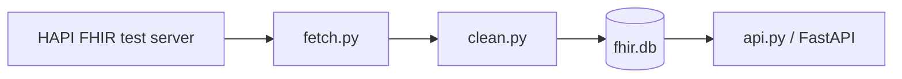

# FHIR Patient Pipeline

A pipeline that fetches FHIR patient data from a public test server, cleans it, stores it in SQLite, and serves it through a REST API.

## About the data

The data comes from the public HAPI FHIR test server. Patient identities (name, record number, birth date) are synthetic, and the measurements come from a public health survey (NHANES). No real patient data is used.

## How it works



- `fetch.py` pages through the server's results, with retries.
- `clean.py` validates each patient and flattens it to `id`, `family_name`, `gender` and `birth_date`.
- `main.py` runs fetch, clean and store, and prints a summary of how many patients were kept and rejected.
- `api.py` serves the stored patients.

## How to run it

```bash
pip install -r requirements.txt       # install dependencies
python main.py                        # run the pipeline: fetch, clean, store in fhir.db
uvicorn api:app --reload              # start a local API server (auto-restarts on changes)
pytest                                # run all tests
docker build -t fhir-api .            # build the Docker image
docker run -p 8000:8000 fhir-api      # start the API from the image
```

The Docker image contains `fhir.db` as it was at build time. To use fresh data, run `python main.py` and rebuild the image.

## API endpoints

- `GET /health`: checks that the API is running.
- `GET /patients`: returns all patients in the database.
- `GET /patients/{id}`: returns one patient by id, or a 404 if not found.

## Design decisions

- **Missing patient id → rejected.** The id is the key used to store and look up every record, so a patient without one can't be found again.
- **Missing family name → rejected.** A record with no name is hard to use or verify, so it's counted as rejected and not stored.
- **Missing or invalid gender → `unknown`.** FHIR defines `unknown` as a valid value, so the record stays usable instead of being dropped over one missing field.
- **Table emptied before each insert.** The pipeline is safe to re-run. Without this, every run would add the same patients again.
- **Fetch capped at a few pages.** The public test server holds thousands of patients. A small sample is enough and keeps runs fast.

## Next steps

- Mount the database as a Docker volume so the container can use fresh data without a rebuild.
- Add authentication to the API.
- Add FHIR Observations (labs and vitals) and join them to patients.